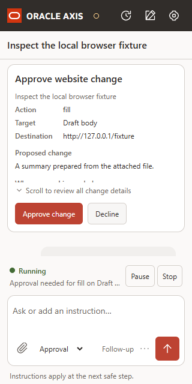
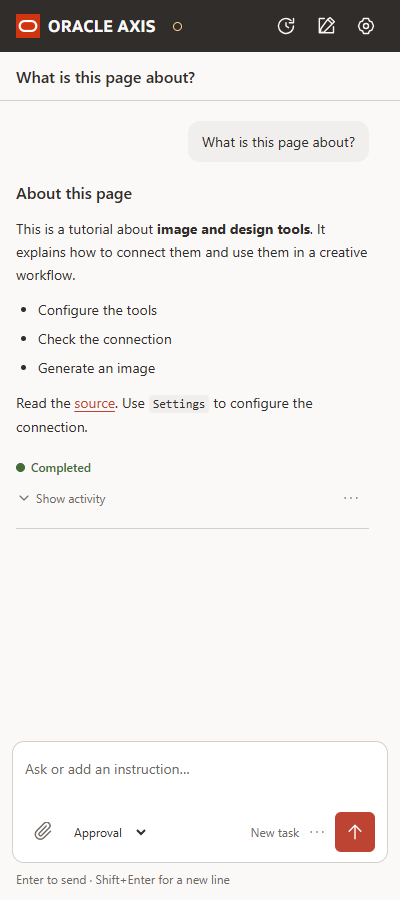

# Axis Agent — Browser Tool Layer


Python browser-control layers that let an LLM-based agent drive Chrome tabs
through [Browser Agent Bridge](../browser-agent-bridge) without exposing
the bridge's ~150-method raw JSON-RPC surface.

Browser tasks start directly with the browser navigator. It can request the
tool-free planner when strategic help is needed; document workflows use the planner. A shared
orchestrator handles tasks from either the Chrome side panel or the CLI, and
`BrowserRuntime` guards every browser tool call. Start with the
[project overview](../README.md) or inspect the
[runtime architecture](../docs/architecture/axis-runtime.html).

| Approval checkpoint | Completed answer |
| :---: | :---: |
|  |  |

*Illustrative screenshots from the local UI fixture.*

## Browser UI setup

Follow the [setup instructions in the main README](../README.md#get-started)
for extension installation, service startup and pairing. Once dependencies and
credentials are configured, start the service from this directory:

```powershell
uv run python -m axis.ui_service --debug
```

Keep it running and enter tasks in the extension. Pair through
**Settings → Connection → Pair AXIS service** using `http://127.0.0.1:8766` and
the `token` in `.axis-ui/pairing.json`. Start the browser bridge in Settings if
needed. Run the UI service or the CLI at a time. The [detailed UI guide](../docs/AXIS_UI.md)
covers controls, debug output, approvals and restart limits.

## CLI command reference

Run AXIS from this directory:

```powershell
uv run python -m axis.cli --help
uv run python -m axis.cli --debug --max-requests 120 --max-steps 60 --max-actions 120
```

Use `uv run python -m axis.cli --help` for the current flags and defaults.
In an interactive process, `/continue` retains task context, `/new` starts
a fresh task, and `/extend` adds explicit request, step, and action budget.

## Long research tasks

For a multi-technology review, allocate a bounded budget explicitly:

```powershell
uv run python -m axis.cli --debug --max-requests 120 --max-steps 60 --max-actions 120
```

The planner keeps a short remaining-work checklist and source notes containing
exact quotations checked against runtime evidence. The source register records
substantive reads, not just opened URLs. Notes, extracts, and the register share
the 32,000-character retention budget; clipping or eviction is reported.
The Navigator receives relevant facts, source URLs, and remaining model requests.
Duplicate source-tab creation reuses the open URL by default; tools can specify
`reuse=false` when a genuinely separate tab is needed. Existing user tabs are
not automatically closed to make room.

If a task reaches its budget, AXIS returns an explicitly incomplete report with
retained sources and remaining work. In the same interactive process, use
`/extend 60` to add model requests, or `/extend 60 30 60` to add requests,
steps, and browser actions respectively. Usage totals remain cumulative; a new
task returns to the configured base limits. `/continue <follow-up>` retains
context without increasing limits; `/new <task>` starts fresh.

`run.synthesis_reserve_requests` defaults to 3 for research planning.
`run.final_answer_max_chars` defaults to 24,000, including citations; the planner
must rewrite oversized answers rather than silently truncate them. These are
in-process continuations, not crash-safe durable execution.

After updating the extension, reload it at `chrome://extensions` and reconnect
the bridge. The resolved-target check blocks prohibited download attributes and
archive links before a click, in addition to the agent's task restrictions.

## Active AXIS runtime versus frozen compatibility layer

The AXIS planner/navigator runtime imports `browser_tools.py`. It keeps six
semantic tools eager (`tabs`, `observe`, `act`, `navigate`, `wait`, `assert`),
progressively adds evidence, diagnostics, downloads, and visual recovery when relevant,
and keeps capability negotiation, site-pattern lookup, popup registration, and
debug recording/tracing inside `BrowserRuntime`. Setup, running, and evaluation
instructions live in the [root README](../README.md); the runtime's own
configurable values are documented inline in [axis.yaml](axis.yaml).

### Active runtime behavior

`run.direct_browser_execution: true` bypasses mandatory planner handoffs for
browser work. The navigator receives the user goal and fresh observation, then
returns `task_complete` with `final_answer` and verified evidence IDs, or
`needs_plan` with a concrete reason. Completion still goes through runtime
validation. Set the option to `false` to retain the planner-first path.

`browser_act` accepts an optional exact `postcondition` and
`command={"action":"batch","steps":[...]}` for up to six ordered click/fill/select/
check actions. Each step contains `command` and an optional `postcondition`;
each action/check pair reserves two calls before either executes. The default
step budget is 12 calls (six pairs). Execution stops on failure, denial, navigation,
popup, invalidated refs or budget exhaustion, before starting an incomplete pair.
For example:

```json
{"tab":"tab_1","command":{"action":"fill","target":{"kind":"locator","locator":{"label":"Name"}},"value":"Alice"},"postcondition":{"assertion":"value","locator":{"label":"Name"},"expected":"Alice"}}
```

Automatic execution binds permission to the selected tab's origin, not its changing
title. UI and CLI share the same scope policy; explicit restrictions, approval mode
and configured mandatory approvals still apply. A new origin is a boundary change.

Numbered browser instructions are retained as ordered task steps. The navigator
records results with runtime evidence IDs; incomplete steps prevent a completion
claim. UI task history checkpoints these results and pending outcomes for restart,
without restoring live refs or screenshots. Failed exploratory assertions remain
in history but are not automatically promoted to required task conditions.

Ordinary CDP attachment does not activate the task tab. Ref and locator clicks share
visible-point selection, including scroll-container clipping and hit testing. Ref
identity changes require a fresh observation. Foreground-only screenshot fallbacks
may still activate their target window.

Snapshots share a 12,000-character budget, retain complete entries, prioritize
focused/dialog controls over prose, and include state and ancestor context.
Scoped observation reads omitted content. Open shadow roots and frames are
collected under their actual identities; ambiguous frame-owner geometry refuses
coordinate dispatch. Password values are omitted from ordinary observations.

The planner declares a goal's expected result with `PlanDecision.verification`
(`GoalCheck`). After a page-state mutation, a matching passing `browser_assert` on the
affected tab must occur before the goal completes. Assertions retain their
locator identity, goal, and action sequence. Observations alone do not clear
pending changes. Runtime evidence carries IDs and source URLs; navigator prose
alone cannot prove required text or a visited URL. A download goal instead uses
completed-download evidence matching its declared filename or URL within the
current task's download window to verify the triggering action.

For a custom control, an inferred value check can become an exact text check
when fresh bridge metadata proves that the same scoped control has no value
property. The expected result stays unchanged; explicit value-property
requirements, ambiguous targets, stale evidence, and uncertain writes cannot use
this correction. The text assertion can supply the metadata itself, so no failing
value probe or extra planner turn is required. Already-correct settings still
need a passing check, but do not require an edit. Workbook progress stores the
accepted check before advancing.

For an inferred descriptive target, the navigator first asserts `count=1` on its
observed scoped locator, then uses `browser_assert(..., goal_target=...)` with the
declared target and unchanged expectation. The runtime binds the locator and tab
before the assertion; later checks cannot replace that scope. Literal-target
checks remain compatible. A running workbook step keeps the same goal identity
across replanning and resume, and uses the same acceptance rule as goal completion.
Repeated completion rejection stops after one recovery even when no changes are
pending. Duplicate passing checks do not reset progress. Workflow reads never
mark a step complete; the runtime records accepted evidence directly.

Route changes are tracked separately from configuration writes and cannot clear
an outstanding Save check. Repeating the same failing assertion on an unchanged
page after a recovery attempt stops with the target, expected/actual result, and
bridge diagnostic. Pause and cancel retain precedence. The extension handshake
advertises property-evidence and attribute-protocol capabilities; an older bridge
produces a compatibility warning instead of silently authorizing weaker checks.
Reload the extension and restart the AXIS service together after updating them.

Both agents receive retained source facts: extracted scalars and structured
values, source URL, tab, goal, target, and evidence ID. Repeated reads from the
same source and target are deduplicated. At most 16 entries and 32,000 characters
of values are retained, with explicit truncation and priority for extractions
and completed goals. `/continue <follow-up>` retains this context; `/new <task>`
starts independent task memory. Plain interactive replies continue only while
paused or waiting for user input; otherwise they start a new task.

`run.visual_mode: auto` enables on-demand image input when the navigator reports
insufficient DOM information or repeated recoverable targeting failures occur.
The optional `browser_visual` tool captures images and supports click, drag,
hover, scroll, and type; keyboard presses still use the ordinary action tool.
Images reach the model as pixels, bounded to 1,600 pixels on their longest edge.
Coordinate actions require the newest screenshot for that tab and unchanged
viewport, URL, scroll state and rendered pixels, and consume the screenshot after use. Existing
firewall, approval, cancellation, mutation, and budget gates still apply.

`browser.allow_coordinate_fallback: true` now enables those coordinate actions
during visual recovery; `false` allows visual reading only. `--visual-mode off`
overrides configuration to disable visual recovery. Automatic image bytes stay
out of task memory, debug events, and persisted evaluation reports. Requested
artifact captures use the separate `browser_capture_evidence` tool. A provider
that explicitly rejects image input before any tool executes disables vision
for that run and receives one text-only retry.

Planner cadence starts at five navigator steps and can extend to eight while
fresh evidence shows progress (`run.planner_interval_steps` and
`run.planner_max_interval_steps`). Set both to the same number for fixed cadence.
Each navigator step allows up to 16 browser calls (`run.max_actions_per_step`),
including observations and assertions. These are ceilings, not minimum batches:
goal completion, blockers, unknown outcomes, pause/cancel and budget limits still
yield early. Whole-task model-request and browser-action budgets are unchanged.
In direct mode, ordinary targeting repairs and verification remain local; the
browser agent requests strategic replanning. In planned mode, completion and
blockers return to the planner. Progress compares meaningful page content and action
results, ignoring regenerated reference IDs; missing change metadata is
unknown rather than evidence of failure. Results include input/output token
totals alongside action, request, and timing counts.

### Executable workflow evaluations

```bash
uv run python -m evals.run --preflight
uv run python -m evals.run --repeat 3
uv run python -m evals.run --case canvas_interaction --config axis.yaml
```

Run these commands from `axis-agent`. The default evaluates all 12 cases three
times sequentially, with fresh loopback origins and task-owned tabs. Independent
fixture state, browser reads, and submission counters determine success and
detect false completion and duplicate actions. Reports include latency, model
requests, browser actions, and input/output tokens. Unavailable bridge/provider
prerequisites are separate from task failures. `--judge` optionally adds a lazy
model judge; it never replaces deterministic checks. Reports live under ignored
`evals/results/` by default. See [evals/README.md](evals/README.md) for details.

### Frozen compatibility reference

The remainder of this README documents the **frozen** `browser_agent_tools.py`,
the older eight-tool compatibility layer and its legacy tests. Its contracts,
coordinate restrictions, and managed-tab binding behavior are preserved; the
active runtime changes above do not apply to that module. The active AXIS
runtime does not load or require browser-contract snapshot files.

```
axis-agent/
├── browser_bridge_client.py     # bridge client (copied verbatim, unmodified)
├── browser_agent_tools.py       # everything else: schemas, tools, dispatch
├── README.md
└── tests/
    └── test_browser_agent_tools.py
```

## The eight tools

| Tool | Purpose | Not for |
| --- | --- | --- |
| `browser_tabs` | List, create, activate, or close tabs through opaque handles | Reading or interacting with page content |
| `browser_observe` | Read the page; mint `ref`s | Modifying the page, verifying success |
| `browser_act` | Interaction, exact postcondition, or bounded form batch | Discovery, navigation |
| `browser_navigate` | Open a URL / reload / back / forward | Clicking a link, verifying the destination |
| `browser_wait` | Wait for a browser condition | Proving a business outcome |
| `browser_assert` | Verify an expected condition | Discovery, mutation |
| `browser_capture_evidence` | Screenshot / snapshot / PDF / trace artifacts | Routine observation |
| `browser_diagnose` | Console / network / DOM / trace investigation | Normal interaction |

The LLM only ever sees these eight names (see `get_tool_definitions()`); it
never selects a raw bridge method, a Chrome `tabId`/`windowId`/`groupId`, a
`snapshotId`, or a `frameId` — those are resolved internally from a
`browserSessionId` and (for element actions) a `ref` minted by
`browser_observe`.

## Quick start

```python
from browser_bridge_client import BrowserBridgeClient
from browser_agent_tools import BrowserAgentTools, get_tool_definitions, get_tool_handlers, BROWSER_AGENT_INSTRUCTIONS

client = BrowserBridgeClient()  # reads BROWSER_AGENT_BRIDGE_* env vars / ~/.browser-agent-bridge.env
tools = BrowserAgentTools(client)

# Bind before starting the agent loop — this is Python setup code, not an LLM tool.
bound = tools.bind_active_managed_tab()
if not bound["ok"]:
    raise SystemExit(bound["error"])  # e.g. NO_MANAGED_TAB
browser_session_id = bound["browserSessionId"]

# Hand these to your LLM function-calling loop:
tool_defs = get_tool_definitions()           # 8 {"type": "function", ...} entries
handlers = get_tool_handlers(tools)          # name -> bound method
system_prompt = BROWSER_AGENT_INSTRUCTIONS

# Each tool call from the model:
result = tools.dispatch("browser_observe", {"browserSessionId": browser_session_id})
```

Every tool returns the same envelope:

```jsonc
{"ok": true,  "browserSessionId": "bs-...", "data": {...}, "error": null}
{"ok": false, "browserSessionId": "bs-...", "data": null,  "error": {"code": "...", "message": "...", "retryable": false, "diagnostic": null}}
```

## Design notes

- **Refs hide the bridge's ref format.** The bridge's compact accessibility
  snapshot embeds refs as `[f0:e12] button "Submit"`. `browser_observe`
  rewrites these to sequential `ref_1`, `ref_2`, ... tokens and keeps the
  `{frameId, bridgeRef}` mapping in `self.observations[observationId]["refs"]`.
  `browser_act` resolves a `ref` back through that map — the LLM never sees
  `f0:e12` or a raw `frameId`.
- **Sessions are Python-side setup, not an LLM tool.**
  `bind_active_managed_tab()` finds Chrome's actually-focused tab (the
  active tab of the last-focused window) and binds it only if it belongs to
  an Agent-managed session — see "Binding the focused tab" below for why
  this isn't a plain `tabs.list` call. It mints a `browserSessionId` and
  stores the tab/window/group ids internally. If the focused tab isn't
  managed, it returns `NO_MANAGED_TAB` and never falls back to an unmanaged
  tab, a session's `mainTabId`, or "the most recently updated session".
- **Scope provider seam.** Every tool builds a sanitized context
  (`semanticTool`, `bridgeMethod`, `browserSessionId`, `bridgeSessionId`,
  `tabId`, `url`, `action`, `requestSummary`) and calls
  `self.scope_provider.authorize(context)` before issuing the RPC. The
  default `ManagedTabGroupScopeProvider` only confirms the session was
  legitimately bound; a future `ExternalFirewallScopeProvider` (defined but
  intentionally `NotImplementedError`) can be swapped in via the
  constructor's `scope_provider=` argument with **no change to the eight
  public tools or their schemas**.
- **The bridge remains the enforcement boundary.** Tab-group isolation is
  already enforced inside the extension (`extension/sw/tab-scope.js`,
  `sessions.js`) — this layer never modifies that. It adds an Axis
  Agent-side layer on top: the LLM can't pick a raw method or tab, and every
  call passes through `_assert_method_allowed()` (the forbidden-method +
  positive-allowlist guard) and the scope provider before any RPC.
- **Redaction and bounding are automatic.** `_ok()`/`_err()` run every
  payload through `_redact_value()`, which recursively blanks
  authorization/cookie/token/password/secret/API-key-shaped keys and caps
  string/list sizes. Individual tools don't need to remember to redact.
- **Observations are invalidated eagerly, not just on navigation.** Every
  `browser_observe` call retires every earlier observation for that
  `browserSessionId` before storing the new one (an older observation must
  never remain independently usable once a fresher one exists), in addition
  to `browser_navigate` and any `browser_act`/`browser_wait` result that
  reports a real navigation. `browser_act` detects that from
  `whatChanged.urlChanged`/`whatChanged.toUrl` (the actual fields
  `wrapWithActionObserver` in `extension/sw/action-observer.js` sets — there
  is no `whatChanged.url`); `browser_wait` detects it from the `url` field
  `page.waitForURL`/`page.waitForNavigation` return directly on a matched
  `url`/`navigation` condition.

## Binding the focused tab

`bind_active_managed_tab()` must bind Chrome's actually-focused tab (the
active tab of the last-focused window), not a proxy for it. The obvious
approach — call `tabs.list({query: {active: true, lastFocusedWindow: true}})`
with no `groupId`, then check whether the result is managed — does not work
against this bridge: `assertRpcTabIsolation()` in `extension/service-worker.js`
hard-rejects `tabs.list` unless `query.groupId` is already a known
Agent-managed group:

```js
if (method === 'tabs.list') {
  if (typeof params.query?.groupId !== 'number') {
    throw new Error('Access denied: tabs.list requires query.groupId for an Agent-managed tab group');
  }
  await assertAgentManagedGroup(params.query.groupId, method);
  ...
}
```

There is no unscoped "list every tab" escape hatch by design. So instead of
asking "what tab is focused, and is it managed?", `bind_active_managed_tab()`
asks the narrower, in-bounds question once per managed session already
known from `session.list`/`session.get`: **"is *this* group's active tab
also the one Chrome currently has focused?"**

```python
bridge.rpc("tabs.list", {"query": {
    "groupId": <that session's managed groupId>,
    "active": True,
    "lastFocusedWindow": True,
}})
```

Chrome has exactly one last-focused window and one active tab per window, so
at most one managed group can ever satisfy that query at once — a non-empty
result is Chrome's real focused tab, already confirmed managed, with no
ambiguity. A tab-based (groupless) managed session has no `groupId` to query
by and is skipped, since there is no bridge-compliant way to confirm its
focus state; this is a real limitation of the current bridge, not a gap in
this layer.

## Tool-definition size

`json.dumps(get_tool_definitions(), separators=(",", ":"))` is about 22KB
(was ~38.5KB before a simplification pass). Repetition was cut by giving
each layer one job instead of restating the same rule everywhere:

- **Tool description** — decision rules, limitations, sequencing (the eight
  short labels: Purpose / When to use / When not to use / Important
  capabilities / Required sequencing / Important limitations / Expected
  result / Recommended next step).
- **Property descriptions** — what the value means and when it's required,
  in one line.
- **`BROWSER_AGENT_INSTRUCTIONS`** — cross-tool workflow and global safety
  rules (e.g. "never invent a ref/browserSessionId/URL/selector/file path")
  stated once, not repeated per property.
- **This README** — bridge-mapping detail and rationale.

## Bridge-method mappings (verified against `extension/service-worker.js`)

| Tool | Case | Bridge method |
| --- | --- | --- |
| `browser_observe` | mode=compact | `page.accessibilityTree` (`format:"compact"`) |
| | mode=aria | `page.ariaSnapshot` |
| | mode=text | `page.readText` |
| `browser_act` | click (ref / locator) | `locator.clickRef` / `locator.click` |
| | fill | `locator.fillRef` / `locator.fill` |
| | press (ref / locator / currently focused element) | `locator.pressRef` / `locator.press` / `keyboard.press` |
| | hover (ref / locator) | `locator.hoverRef` / `dom.hover` † |
| | select | `locator.selectOptionRef` / `locator.selectOption` |
| | check / uncheck | `locator.check` / `locator.uncheck` — **locator only**; `ref` is always rejected ‡ |
| | upload | `locator.setInputFiles` (locator only — no ref method exists) |
| | drag | `locator.dragTo` (locator only — no ref method exists) |
| | scroll | `dom.scroll` (`mode:"scrollBy"`) |
| `browser_navigate` | open/reload/back/forward | `page.navigate` / `page.reload` / `page.goBack` / `page.goForward` |
| `browser_wait` | element_state | `locator.waitFor` |
| | url / request / response | `page.waitForURL` / `page.waitForRequest` / `page.waitForResponse` (as `urlContains`) |
| | navigation / page_load / network_idle / text / popup / dialog | `page.waitForNavigation` / `page.waitForLoad` / `page.waitForNetworkIdle` / `page.waitForText` / `page.waitForPopup` / `page.waitForDialog` |
| `browser_assert` | visible…checked, value, text, count, attribute | `expect.locator.toBe*` / `toHave*` |
| | title, aria_snapshot | `expect.page.toHaveTitle` / `expect.page.toMatchAriaSnapshot` |
| `browser_capture_evidence` | page/element screenshot, dom/accessibility snapshot, pdf | `page.screenshot` / `locator.screenshot` / `page.domSnapshot` / `page.accessibilityTree` / `page.pdf` |
| | trace start/stop/export | `trace.start` / `trace.stop` / `trace.exportHtml` |
| `browser_diagnose` | console/network/dom/trace_status | `console.read` / `network.read` / `page.domSnapshot` / `trace.status` |
| | response_body (opt-in) | `network.getResponseBody` |

† **Correction to the brief's suggested fallback list**: the bridge has no
`locator.hover` method (only `locator.hoverRef`, `dom.hover`, and
`computer.hover` exist — verified in `service-worker.js`). A locator-based
hover with no `ref` therefore falls back to `dom.hover`, which requires a
CSS `selector`; a role/text/name/label/placeholder-only locator cannot hover
without a ref. This is documented in the `browser_act` tool description and
enforced with `INVALID_ARGUMENT` if violated.

`locator.setInputFilesRef` does not exist in the bridge, so `upload` rejects
a supplied `ref` and requires `locator`. The public schema has no
`targetRef` field at all (see below) — `drag` always requires both
`locator` and `targetLocator`.

‡ **Check/uncheck are locator-only; there is no ref path.** The bridge has
no `checkRef`/`uncheckRef` — its only ref-based path for a checkbox/radio is
`locator.clickRef`, which unconditionally *toggles* whatever is currently
there rather than setting an explicit state. That is nondeterministic
against a live page (the box may have changed since the ref was captured,
or a concurrent event may have changed it), so a ref is always rejected for
`check`/`uncheck` with `INVALID_ARGUMENT`; `locator.check`/`locator.uncheck`
read and set the state explicitly instead of toggling it.

### `a11yDiff` is never sent on a ref action

`locator.clickRef`/`fillRef`/`pressRef`/`hoverRef`/`selectOptionRef` never
set `a11yDiff: true`. The bridge's action observer
(`wrapWithActionObserver` in `extension/sw/action-observer.js`) only
captures a full pre/post accessibility tree when `a11yDiff` is truthy, and
doing so calls `page.accessibilityTree`, which mints and installs a **new**
`snapshotId` server-side (`refState.snapshotId` in
`extension/content/accessibility-tree.js`) *before* the ref action itself
runs. The ref action then arrives carrying this observation's now-superseded
`snapshotId`, and the content script rejects it:

```js
if (message.snapshotId && message.snapshotId !== refState.snapshotId) {
  throw new Error(`Stale accessibility ref snapshot: ${message.snapshotId}`);
}
```

Sending `a11yDiff: true` would make every ref-based action fail against a
freshly-observed page. Omitting it keeps the observer's cheap default probe
(URL/focus/popup deltas via `whatChanged`) without ever re-minting a
snapshot out from under the ref in use. `browser_act` still detects a
resulting navigation from `whatChanged.urlChanged`/`whatChanged.toUrl`
(the fields the observer actually sets — there is no `whatChanged.url`) and
invalidates observations accordingly.

Both of the messages the content script can throw for this — `Stale
accessibility ref snapshot: ...` and `Accessibility ref not found or
stale: ...` — are normalized by `_bridge_error_response()` to
`STALE_OBSERVATION` (retryable, instructing the agent to call
`browser_observe` again). The tool never retries the old ref itself.

## Forbidden methods

`FORBIDDEN_METHODS` in `browser_agent_tools.py` blocks (defense-in-depth,
checked in `_assert_method_allowed()` before every RPC, in addition to the
per-tool mapping tables which never produce these):
`cookies.get`, `page.executeJavaScript`, `page.addInitScript`,
`page.removeInitScript`, `page.waitForFunction`, `page.setExtraHTTPHeaders`,
`page.setUserAgent`, `extension.reload`, `extension.getCspBypass`,
`policy.get/set/checkUrl`, `network.setBlockedUrls`,
`network.setInterceptors`, `network.routeFromHAR`,
`network.interceptors.clear(Events)`, plus tab/session lifecycle methods
(`session.start/stop`, `tabs.create/close`) that this layer never needs
since it only binds to an already-existing managed tab.
`computer.*` (coordinate/mouse-position control) has no opt-in at all — it
is simply absent from `_ALLOWED_METHODS`, so it is unreachable
unconditionally. No public schema in this layer accepts coordinates and no
internal mapping needs `computer.*`, so there is nothing to gate; an earlier
`allow_coordinate_fallback` constructor flag has been removed entirely
rather than left dormant.

`_assert_method_allowed()` is a **positive allowlist**, not just a denylist:
a method must also appear in `_ALLOWED_METHODS` (the ~40 methods the mapping
tables above actually use). A typo'd, invented, or future/unmapped method
name (e.g. `totally.unknown`) is rejected even though it was never added to
`FORBIDDEN_METHODS` — membership in the forbidden set is sufficient but not
necessary for a call to be blocked. `native.saveDataUrl` (used by
`browser_capture_evidence`) goes through `BrowserBridgeClient.save_data_url()`
rather than `.rpc()`, so it can't pass through `_assert_method_allowed()` at
all; `_save_data_url()` checks its own explicit allowlist
(`_ALLOWED_NATIVE_METHODS`) and refuses anything that isn't a genuine
`data:` URL before calling it.

## Known limitations / assumptions

- `browser_wait`'s `url`/`request`/`response` conditions match `expected` as
  a substring (`urlContains`) rather than an exact match, since that is more
  forgiving of query-string/hash variation for an LLM caller.
- `browser_act`'s `scroll` action scrolls the whole page by default; passing
  a `locator.selector` scrolls that specific container (`dom.scroll`
  supports an optional CSS selector). Scrolling a `ref`-identified element
  is not supported (the bridge's `dom.scroll` takes a CSS selector, not a
  ref).
- `browser_diagnose`'s `dom` diagnostic and `browser_capture_evidence`'s
  `dom_snapshot`/`trace_export` captures can be large; they are summarized
  (diagnose) or written to disk via `BrowserBridgeClient.save_data_url`
  (capture, base64-encoded on the way in) rather than ever returned inline
  as a large payload.
- `browser_assert` distinguishes "the condition was evaluated and is false"
  from "the call itself failed" using the bridge's own error code, not a
  message-text guess. Three codes mean a genuine assertion mismatch/timeout:
  `LOCATOR_EXPECT_TIMEOUT` (`extension/sw/locator.js`'s
  `createLocatorExpectTimeoutError`, used by every `expect.locator.*` except
  `toBeVisible`/`toBeHidden`), `PAGE_EXPECT_TITLE_TIMEOUT`, and
  `PAGE_EXPECT_ARIA_SNAPSHOT_TIMEOUT` (both `extension/sw/page.js`, via the
  shared `createPageWaitTimeoutError`). `toBeVisible`/`toBeHidden` go through
  `locator.waitFor`, which throws a plain, uncoded `Error` on timeout — its
  distinctive message shape is the one exception recognized without a code.
  Any other failure — a tab-scope rejection, an invalid-parameter error, a
  `LOCATOR_STRICT_MODE_VIOLATION`/`LOCATOR_ACTIONABILITY_TIMEOUT`-style
  coded error, a transport failure, or anything else — falls through to the
  normal `ok:false` error contract via `_bridge_error_response()` /
  `_is_assertion_mismatch_error()`. On a mismatch, the bridge's structured
  diagnostic (`error.data.diagnostic` — actual/expected values, elapsed
  time, missing ARIA lines, the current title, ...) is preserved into
  `data.diagnostic`, redacted and bounded like every other payload, instead
  of being discarded. `data.expected` always echoes the value from the
  public tool arguments (`cleaned.get("count")` for the `count` assertion,
  `cleaned.get("expected")` otherwise) rather than the internal bridge
  `params` dict, which never has an `expected` key for `title` (it uses
  `title`/`titleContains`) or a `count` key at all.
- `_bridge_error_response()` also distinguishes HTTP status ranges rather
  than lumping every 4xx/5xx into `BRIDGE_UNAVAILABLE`: 401/403 (bad/missing
  bearer token) and other 4xx map to `BRIDGE_ERROR` (not retryable — a
  config problem, not an outage), 5xx maps to `BRIDGE_UNAVAILABLE`
  (retryable), and a genuine socket-level failure (connection refused, DNS
  failure, ...) also maps to `BRIDGE_UNAVAILABLE`.
- `bind_active_managed_tab()` binds Chrome's actually-focused tab (see
  "Binding the focused tab" above), not a proxy for it — it iterates managed
  sessions (ordered by `(updatedAt, createdAt, id)` descending, purely for
  reproducible iteration) and asks `tabs.list` a groupId-scoped focus query
  for each; since Chrome has one last-focused window and one active tab per
  window, at most one candidate can ever match. It returns only
  `{"browserSessionId", "url"}` in `data`; the internal
  `tabId`/`windowId`/`groupId`/`bridgeSessionId` stay in
  `self.browser_sessions` and are never handed back to the caller. A managed
  session with no `groupId` (tab-based only) cannot be checked this way and
  is skipped rather than guessed at.
- `get_tool_definitions()` returns a deep copy of the module-level schema
  list on every call, so a caller that mutates what it got back (e.g. an SDK
  annotating tool dicts in place) cannot corrupt the schemas seen by any
  other caller or session.

## Running the tests

```bash
cd axis-agent
python -m pytest tests/test_browser_agent_tools.py -v
```

No Chrome instance or running bridge is required — `BrowserBridgeClient.rpc`
is mocked throughout.

### Supplied login credentials

AXIS passes supplied usernames and passwords unchanged to its model and browser
actions. It does not substitute credential tokens or redaction markers in prompts,
action history, approval details, or debug events. These records can contain the
supplied values.

In Automatic mode, an explicit login authorizes credential fields and Sign In on
the application origin. A successful task-initiated navigation to that application
also records the resulting SSO login origin for the same task tab. Matching a
redirect query parameter alone does not grant this authorization. Origin checks
include scheme and port, and form submission must stay within the authorized
application or login origin.
